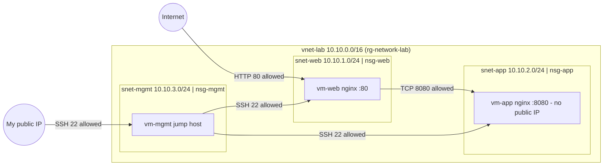

# Secure Network Segmentation in Azure

A hands-on cloud networking lab that builds a three-tier network in Microsoft Azure (web, application and management subnets), restricts traffic between tiers with Network Security Groups (NSGs) using least-privilege rules, and then **proves the rules work** with Azure Network Watcher and real traffic tests.

**Author:** Ruhina Sardar Rumi | Cloud Computing Technologies, George Brown Polytechnic | [LinkedIn](https://www.linkedin.com/in/ruhina-sardar-rumi/)

## Why this project

Segmenting a network and allowing only the traffic that is needed is a core part of IT support, cloud and security work. This lab shows how to design address space and subnets, write and order firewall rules, and troubleshoot connectivity when traffic is blocked.

## Architecture



| Subnet | Address range | Purpose | Public IP |
|---|---|---|---|
| snet-web | 10.10.1.0/24 | Public web tier | Yes |
| snet-app | 10.10.2.0/24 | Internal application tier | No |
| snet-mgmt | 10.10.3.0/24 | Management (jump host) | Yes (SSH from my IP only) |

## Traffic rules (NSG, inbound)

| NSG | Priority | Rule | Source | Port | Action |
|---|---|---|---|---|---|
| nsg-web | 100 | Allow-HTTP-Internet | Internet | 80 | Allow |
| nsg-web | 110 | Allow-SSH-From-Mgmt | 10.10.3.0/24 | 22 | Allow |
| nsg-web | 4000 | Deny-All-Inbound | Any | Any | Deny |
| nsg-app | 100 | Allow-8080-From-Web | 10.10.1.0/24 | 8080 | Allow |
| nsg-app | 110 | Allow-SSH-From-Mgmt | 10.10.3.0/24 | 22 | Allow |
| nsg-app | 4000 | Deny-All-Inbound | Any | Any | Deny |
| nsg-mgmt | 100 | Allow-SSH-From-MyIP | My public IP | 22 | Allow |
| nsg-mgmt | 4000 | Deny-All-Inbound | Any | Any | Deny |

Azure's default rule `AllowVnetInBound` (priority 65000) would otherwise let every subnet talk to every other subnet, so an explicit `Deny-All-Inbound` at priority 4000 is what actually enforces the segmentation.

## Skills demonstrated

Azure Virtual Networks and subnets, CIDR and IP addressing, Network Security Groups and rule priority, least-privilege access, jump host (bastion) design, Azure CLI scripting, Network Watcher (IP flow verify), connectivity troubleshooting, and cost cleanup.

## How to run it

1. Open [Azure Cloud Shell](https://shell.azure.com) in Bash mode (an Azure free account or student subscription works).
2. Clone this repo and run the scripts:

```bash
git clone https://github.com/ruhinasardar-rumi/azure-secure-network-segmentation.git
cd azure-secure-network-segmentation/scripts
./deploy.sh      # builds the network, NSGs and 3 small VMs (about 10 minutes)
./verify.sh      # tests every rule and prints expected vs actual
./cleanup.sh     # deletes everything so there are no ongoing charges
```

> Cost note: the lab uses three small Standard_B1s VMs. Run `cleanup.sh` as soon as you have your screenshots.

## Expected test results

| # | Test | Expected |
|---|---|---|
| 1 | Internet to web VM on port 80 | Allow |
| 2 | Internet to web VM on port 22 (SSH) | Deny |
| 3 | Management subnet to web VM on port 22 | Allow |
| 4 | Web subnet to app VM on port 8080 | Allow |
| 5 | Management subnet to app VM on port 8080 | Deny |
| 6 | Internet to app VM on port 22 | Deny |
| 7 | Management subnet to app VM on port 22 | Allow |

## Results


## Troubleshooting notes

See [docs/troubleshooting-cheatsheet.md](docs/troubleshooting-cheatsheet.md) for the commands and the step-by-step method used to diagnose blocked connections (ping, traceroute, nslookup, curl, nc and Azure effective security rules).

## Cleanup

```bash
./scripts/cleanup.sh
```

## Possible next steps

Add Azure Bastion instead of a public jump host, add a private DNS zone, peer a second VNet, send NSG flow logs to a Log Analytics workspace, and rebuild the same network with Bicep or Terraform.# Azure-Network-Project
